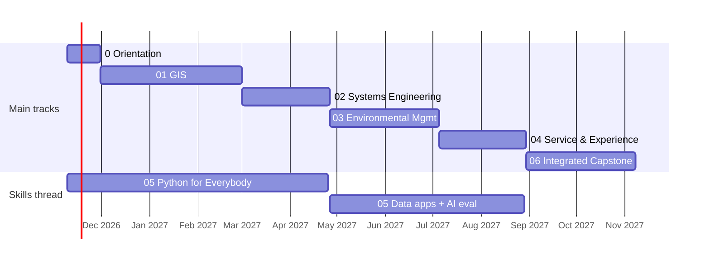

# Roadmap

**Duration:** 12 months, Nov 9 2026 → Nov 7 2027
**Time budget:** 5–8 hrs/week alongside client work (plan on ~6.5, about 330 hours in total)
**Structure:** overlapping. One *main track* at a time gets most of the week. **05 · Data, Software & AI** runs all year as a *skills thread*, because every other track uses it.

Course details (hours, prices, dates) were checked in November 2026. Confirm them on each course page before enrolling.

---

## Weekly rhythm

| Block | Time | What |
|---|---|---|
| Main track, learning | ~2.5 hrs | Course modules, reading, notes in `Courses/` |
| Main track, practice | ~2 hrs | One exercise using the [exercise loop](claude-code-in-the-curriculum.md#the-exercise-loop), recorded with the [template](templates/exercise-template.md) |
| Skills thread (05) | ~2 hrs | Python, SQL, apps and AI, applied to the main track's data where possible |
| Weekly log | 10 min | One line per week in `progress-log.md`: what I did, what I verified, what's next |

On light weeks (client crunch, holidays), keep only the skills thread and the log. On heavy weeks, add practice, not more course content.

---

## Timeline at a glance

| Phase | Dates | Weeks | Main track | Skills thread (05) |
|---|---|---|---|---|
| 0 · Orientation | Nov 9 – Nov 29, 2026 | 3 | Claude Code workflow and tool setup | Python for Everybody, course 1 |
| 1 · GIS | Nov 30, 2026 – Feb 28, 2027 | 13 (incl. holiday slack) | 01 GIS & Spatial Intelligence | Python for Everybody, courses 2–3 |
| 2 · Systems Engineering | Mar 1 – Apr 25, 2027 | 8 | 02 Systems Engineering | Python for Everybody, course 4 (databases & SQL) |
| 3 · Environmental Management | Apr 26 – Jul 4, 2027 | 10 | 03 Environmental Management (spring/summer field season) | Database and loader for monitoring data |
| 4 · Service & Experience Design | Jul 5 – Aug 29, 2027 | 8 | 04 Service & Experience Design | API, dashboard and AI evaluation → **05 Portfolio Project** |
| 5 · Integrated Capstone | Aug 30 – Nov 7, 2027 | 10 | 06 Integrated Capstone (full ~6.5 hrs/week) | Folded into the capstone |

---

## Phase 0 · Orientation (Nov 9 – Nov 29, 2026)

**Goal:** a working setup and a working habit before any real track content.

| Course / resource | Why | Effort |
|---|---|---|
| **[Claude Code in Action](https://anthropic.skilljar.com/claude-code-in-action)**, Anthropic Academy (free) | CLAUDE.md, plan mode, skills, hooks, verifying unsupervised runs. Matches how this repo is set up. | ~3–5 hrs |
| **[Python for Everybody](https://www.coursera.org/specializations/python)**, University of Michigan, course 1 | Starts the skills thread | ~17 hrs (spread over Phase 0–1) |

**Milestones**
- [ ] Install QGIS and a Python environment (GeoPandas) for Phase 1; record the setup in `05_Data-Software-AI/Python/README.md`
- [ ] Complete one practice exercise end to end with the template, on any small dataset
- [ ] Create `progress-log.md`

---

## Phase 1 · 01 GIS & Spatial Intelligence (Nov 30, 2026 – Feb 28, 2027)

**Goal:** process and analyze spatial data in Python, and understand the CRS, data models and operations behind it.

| Course / resource | Role | Notes |
|---|---|---|
| **[QGIS Training Manual](https://docs.qgis.org/latest/en/docs/training_manual/)** (free) | Core: concepts, done by hand in a GUI | Do the vector, raster and analysis modules first. This is your by-hand check for Claude Code's scripts. |
| **[Geocomputation with Python](https://py.geocompx.org/)**, Dorman, Graser & Nowosad (free online; print edition 2025) | Core: GeoPandas, rasterio, reprojection, geometry operations | Pairs directly with the starter exercises |
| [Penn State GEOG 485: GIS Programming](https://geospatial.psu.edu/geog485) (free OER materials) | Optional: Python scripting in ArcGIS Pro | Only if you want ArcGIS skills (needs a license) |
| [UC Davis GIS Specialization](https://www.coursera.org/specializations/gis) (Coursera) | Optional: structured, certificated alternative | ArcGIS-based |

**Schedule**
- Weeks 1–4: QGIS fundamentals plus Geocomputation chapters on vector and raster data. *Light weeks Dec 21 – Jan 3.*
- Weeks 5–9: spatial operations, reprojection and overlays. Starter exercises: reproject & clip, buffer & overlay statistics.
- Weeks 10–13 (Feb 8 – 28): **Portfolio project**, plus the batch-automation exercise.

**Milestones**
- [ ] Three GIS exercises recorded, each verified against QGIS
- [ ] Portfolio project purpose filled in `01_GIS-Spatial-Intelligence/Portfolio-Project/CLAUDE.md`
- [ ] Portfolio project documented (all log headings filled)
- [ ] **Checkpoint review** (end of Feb): adjust the rest of the timeline

---

## Phase 2 · 02 Systems Engineering (Mar 1 – Apr 25, 2027)

**Goal:** write testable requirements, model a system's boundaries and components, and keep the documentation true to the build.

| Course / resource | Role | Notes |
|---|---|---|
| **[Introduction to Systems Engineering](https://www.coursera.org/learn/introse)**, UNSW Sydney (Coursera) | Core | Beginner, ~20 hrs, 9 modules: life cycle, requirements, conceptual and detailed design, managing SE projects |
| **[MIT OCW 16.842 Fundamentals of Systems Engineering](https://ocw.mit.edu/courses/16-842-fundamentals-of-systems-engineering-fall-2015/)** (free) | Core, selected lectures | Watch the requirements, concept generation and V-model lectures for depth |

**Schedule**
- Weeks 1–4: UNSW course, plus requirements-with-traceability exercise.
- Week 5: selected MIT lectures, plus architecture-diagrams-as-code exercise.
- Weeks 6–8 (Apr 5 – 25): **Portfolio project**. A good choice is a requirements and architecture package for the system the GIS and environmental tracks will feed.

**Milestones**
- [ ] Requirements doc with IDs and a traceability matrix you built yourself
- [ ] Mermaid context and component diagrams in `Diagrams/`
- [ ] Portfolio project documented
- [ ] **Checkpoint review** (end of Apr)

---

## Phase 3 · 03 Environmental Management (Apr 26 – Jul 4, 2027)

**Goal:** understand environmental monitoring (sampling, units, standards, QA/QC) and build tools that process real monitoring data honestly. Timed for spring and summer so field research is possible.

| Course / resource | Role | Notes |
|---|---|---|
| **[Global Environmental Management](https://www.coursera.org/learn/global-environmental-management)**, Technical University of Denmark (Coursera) | Core: environmental management systems and approaches | Check the course page for current hours |
| **[EPA Watershed Academy](https://www.epa.gov/watershedacademy/online-training-watershed-management)** (free) | Core: monitoring and standards | Start with *Overview of Watershed Monitoring*, *Monitoring and Assessment*, and *Intro to Water Quality Standards*. 15 core modules lead to an optional certificate. |
| [Water Quality Portal](https://www.waterqualitydata.us/) (free data) | Data source | Real monitoring data for exercises; record source and access date every time |
| [Environmental Project Management Specialization](https://www.coursera.org/specializations/environmental-project-management), U. Maryland (Coursera) | Optional | If the capstone leans toward project delivery |

**Schedule**
- Weeks 1–4: DTU course plus EPA monitoring modules. Exercise: monitoring data loader.
- Weeks 5–7: EPA standards modules. Exercises: summary statistics by site and period, threshold-exceedance alerts.
- Weeks 8–10 (Jun 14 – Jul 4): **Portfolio project**, with field research if feasible.

**Milestones**
- [ ] Every threshold used has a cited source in the README
- [ ] At least one field-research session recorded in `Field-Research/`
- [ ] Portfolio project documented

---

## Phase 4 · 04 Service & Experience Design (Jul 5 – Aug 29, 2027)

**Goal:** formalize service design method (research, journeys, blueprints) and use Claude Code to turn designs into working interfaces. Builds on your existing UX/product practice, so this phase is shorter.

| Course / resource | Role | Notes |
|---|---|---|
| **[Human-Centered Service Design](https://www.ideou.com/products/human-centered-service-design)**, IDEO U | Core (paid) | 5-week cohort, ~4 hrs/week, $899. Covers journey maps, prototyping and blueprints. The page lists cohorts starting Apr 15, May 27, Jul 8 and Sep 30; confirm the 2027 dates. |
| **[This Is Service Design Doing](https://www.thisisservicedesigndoing.com/)**, Stickdorn et al. (book plus free method library) | Free alternative or companion | Use the method library for blueprint and journey templates |

**Schedule**
- Weeks 1–5: IDEO U cohort (or the book and method library). Exercise: research synthesis support.
- Weeks 6–8 (Aug 9 – 29): **Portfolio project**: Figma or blueprint → working interface, ideally the front end of the environmental tool from Phase 3.

**Milestones**
- [ ] Service blueprint for the portfolio project
- [ ] Working interface passes an accessibility check and a small usability test
- [ ] Portfolio project documented
- [ ] Decide whether to connect Figma to Claude

---

## Skills thread · 05 Data, Software & AI (all year, ~2 hrs/week)

| When | Focus | Resource |
|---|---|---|
| Nov 2026 – Apr 2027 | Python, files, web data, **databases & SQL** | [Python for Everybody](https://www.coursera.org/specializations/python), U. Michigan: 5 courses, ~79 hrs; courses 1–4 are core, 5 (visualization capstone) is optional |
| May – Jun 2027 | Schema and loader for Phase 3 monitoring data | Starter exercise: database schema |
| Jul – Aug 2027 | API, dashboard, AI-assisted workflow with an evaluation set | Starter exercises: API & dashboard, AI workflow with evaluation → **05 Portfolio Project** (due Aug 29) |

---

## Phase 5 · 06 Integrated Capstone (Aug 30 – Nov 7, 2027)

**Goal:** one environmental–experiential system that combines all five tracks: spatial analysis (01), a requirements and architecture backbone (02), real monitoring data (03), a designed service and interface (04), and data/AI infrastructure (05).

**Schedule**
- Weeks 1–2: define the problem, write the requirements (reuse the Phase 2 approach), fill in the capstone `CLAUDE.md`.
- Weeks 3–8: build in small increments, verifying as you go.
- Weeks 9–10: end-to-end verification, then write the case study.

**Milestones**
- [ ] Capstone `CLAUDE.md` purpose, scope and data sources filled in
- [ ] End-to-end verification plan executed
- [ ] Case study published (e.g. on your portfolio site)
- [ ] **Final review** (Nov 2027): what to carry into paid client work

---

## Budget

| Item | Cost |
|---|---|
| Claude Code in Action, QGIS Training Manual, Geocomputation with Python (online), MIT OCW, EPA Watershed Academy, Water Quality Portal | Free |
| Coursera courses (Python for Everybody, UNSW, DTU) | Free to audit where offered; certificates need a paid plan |
| IDEO U Human-Centered Service Design | $899 (optional; free alternative listed) |
| ArcGIS Pro (only for the optional GEOG 485 or UC Davis path) | License required |

---

## Review checkpoints

At the end of Feb, Apr, Aug and Nov 2027, spend 30 minutes on:
1. What's on schedule, and what slipped?
2. Which exercises taught the most?
3. Is the next phase still the right one? Reorder if client work or field season suggests it.
4. Update this roadmap and the portfolio logs.
